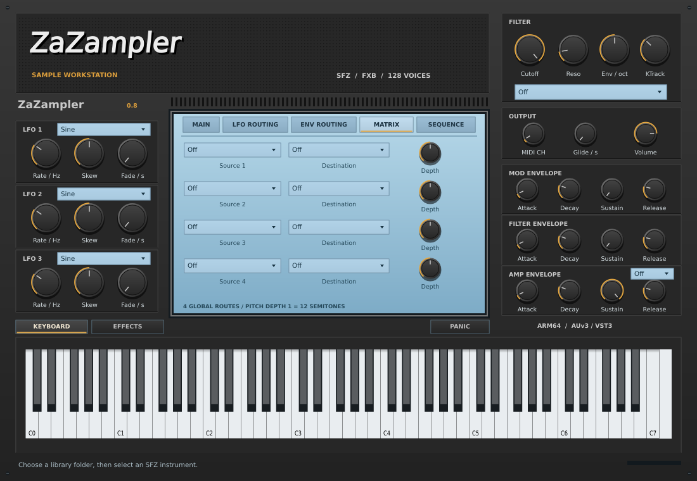
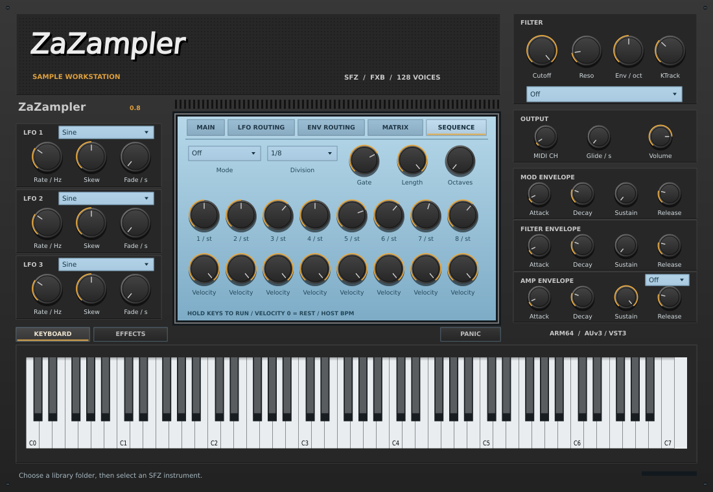
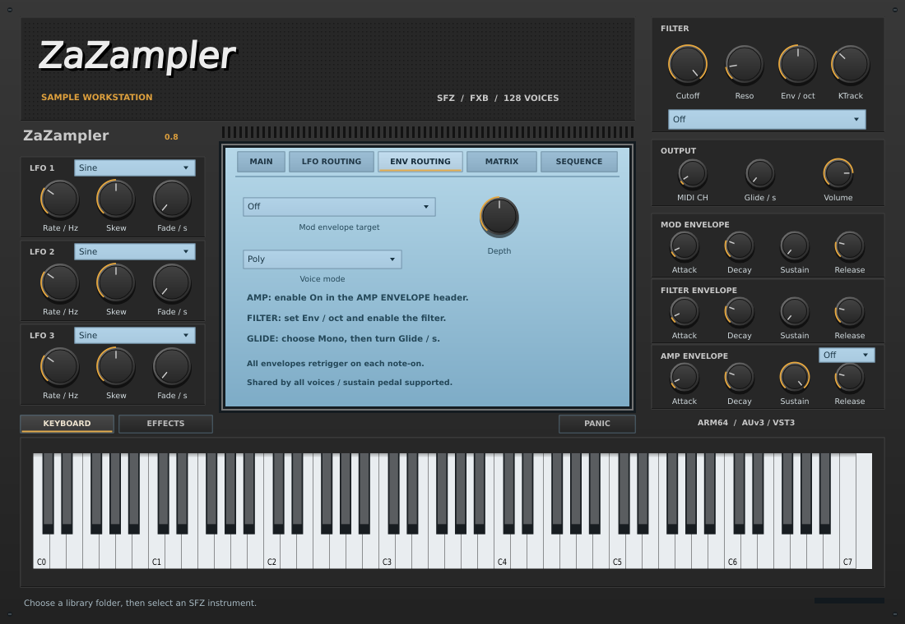
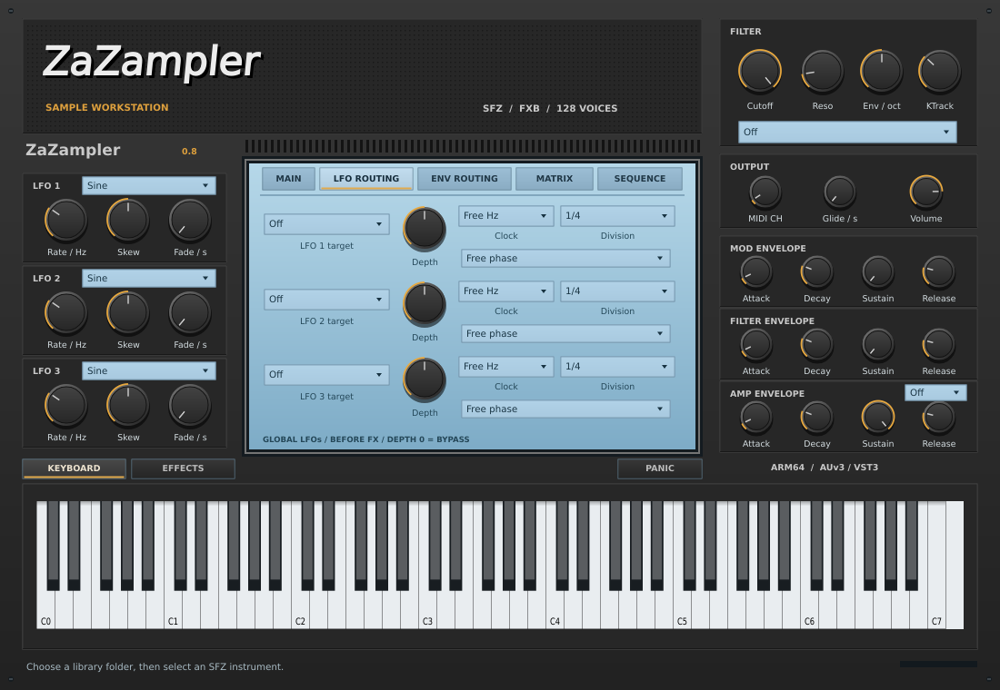
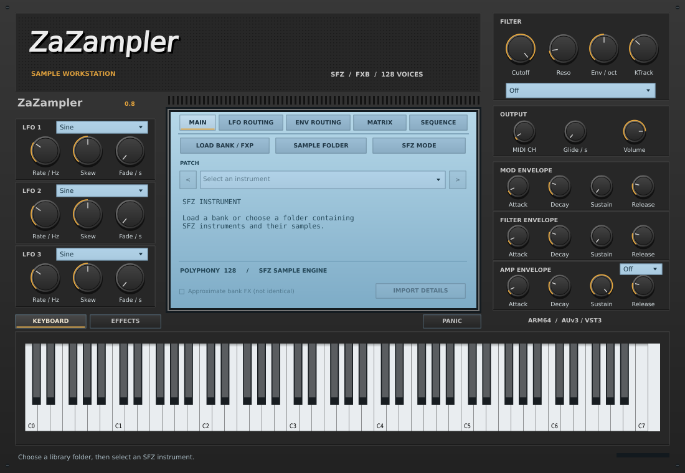

# ZaZampler 0.9.5 — ZamplerのSFZ音色を利用するサンプラープラグイン

M1 MacBook Pro向け **arm64ネイティブ / AUv3・VST3** のソースプロジェクトです。
互換用にAUv2とStandaloneもビルドします。JUCE 8.0.6 + sfizz 1.2.3 + VelociLoopsを固定コミットで取得します。

macOS arm64のビルド・自動テスト・署名検証をGitHub Actionsで実施しています。
[ReleasesのAssets](https://github.com/nokamoto777/zazampler/releases)から `ZaZampler-macOS-arm64.zip` を取得できます。
開発版はアドホック署名で、Apple公証は含みません。指定のmacOSや各DAWでの起動・演奏は実機確認が必要です。
変更履歴は [CHANGES.md](CHANGES.md)、検証記録は [docs/VALIDATION.md](docs/VALIDATION.md) を参照してください。

## 「Zampler互換」の範囲

Zamplerと同じSFZファイルおよび参照サンプルを読み込む「音色素材の互換」を対象にしています。
Zampler本体の複製、ドロップイン置換、同一音質の再現ではありません。メーカーとの提携はありません。

| 対象 | この実装 |
|---|---|
| SFZ + WAV等のサンプル | sfizzが解釈できる範囲で対応。WAVを回帰テスト済み |
| キー／ベロシティ分割・ループ・エンベロープ | SFZの指定をsfizzで処理 |
| SFZの独自／非対応opcode | 完全互換は保証しない。未知opcodeをステータスに表示 |
| Zamplerの `.fxb` / `.fxp` | 確認済みチャンク形式の音色一覧・SFZ参照・フィルター／FXの近似変換に対応 |
| REX / REX2 / `.rx2` / `.rcy` | 内蔵デコーダーでスライスを読み込み、MIDIノートに割り当て。ループ全体の自動テンポ追従再生は別途未対応 |
| フィルター・FX | 独自DSPを追加。種類・設定は下記参照。本家のアルゴリズム／出音一致は未検証 |
| LFO | 3基、Global / Per voice切替。6波形・テンポ同期。FXB設定を近似取り込み |
| MOD MATRIX・シーケンサー | 32行のマトリクス、Up/Downアルペジオ、8ステップ、Tie、DAW位置同期。FXBは確認済みの設定を近似取り込み |
| 既存DAWプロジェクトのZampler自動置換 | 非対応。別プラグインとして挿し、MIDIを渡す |
| AUv3 / VST3 / AUv2 | macOS arm64 CIでビルド・署名検証済み。DAW実機検証は未実施 |

Zamplerで購入・取得した全ライブラリがそのまま再現されるとは限りません。
FXB側の設定は近似変換です。LFO、3基のADSR、対応するマトリクス経路、Glide、Mono、Keytrack、アルペジエーターの基本設定を取り込みます。未対応の経路、本家固有のArp/ArpFingerステップ符号やTiesはIMPORT DETAILSに明示します。

## バイナリのダウンロード

1. [GitHub Releases](https://github.com/nokamoto777/zazampler/releases)を開き、利用するビルドの **Assets** を展開します。
2. `ZaZampler-macOS-arm64.zip` をダウンロードして展開します。`Source code` はソースのみです。
3. 展開先へターミナルで移動し、DAWを終了して `bash scripts/install-macos.sh` を実行します。

mainの更新・mainからの手動実行では `ci-実行番号` の開発版Release、`v` タグではそのタグのReleaseを作成します。
ビルド・テストが成功したバイナリとSHA-256チェックサムをAssetsへ保存します。PRの検証ビルドはActionsのArtifactsから取得できます。
詳しくは [docs/GITHUB_ACTIONS.md](docs/GITHUB_ACTIONS.md) を参照してください。

## ウィンドウサイズ

右下のグリップをマウスでドラッグして拡大・縮小できます。対応ホストではウィンドウ枠からもリサイズできます。
既定は1100×760、範囲は660×456～2200×1520です。ノブ・文字・鍵盤を含めて比例拡縮し、異なる縦横比では余白を設けます。

## Macでビルド

必要なもの：フル版Xcode（Command Line ToolsのみではAUv3をビルドできません）、CMake、Git、初回依存取得用インターネット接続。
Xcodeを一度起動して初期設定を完了してください。CMake未導入なら `brew install cmake` などで導入します。

ZIPを展開し、ターミナルでZaZamplerフォルダーに移動して実行：

```bash
bash scripts/build-macos.sh
```

- Xcode generatorを使用し、arm64、最低macOS 12.0でビルドします。
- AUv3はStandaloneアプリ内の `.appex` として組み込まれます。
- 既定はローカル実行用のアドホック署名。配布・公証済みの署名ではありません。
- Xcodeの署名設定にチームが必要な場合は、自分のTeam IDを指定できます。

```bash
DEVELOPMENT_TEAM=あなたのTeamID bash scripts/build-macos.sh
```

生成物：`build-macos/ZaZampler_artefacts/Release/` 配下の `VST3`、`AU`、`AUv3`、`Standalone`。
コードや署名でエラーが発生した場合、エラーを省略せず保存してください。

## インストール

DAWを終了してから実行：

```bash
bash scripts/install-macos.sh
bash scripts/validate-macos.sh
```

| 種類 | 配置先 |
|---|---|
| VST3 | `~/Library/Audio/Plug-Ins/VST3/ZaZampler.vst3` |
| AUv2 | `~/Library/Audio/Plug-Ins/Components/ZaZampler.component` |
| AUv3入りアプリ | `~/Applications/ZaZampler.app` |

インストーラーがStandaloneを一度開きます。その後終了し、DAWを再起動／再スキャンしてください。
AUv3は対応ホストで使用します。Ableton LiveではまずVST3を使用してください。
旧ビルドがある場合は `~/Library/Application Support/ZaZampler/Backups/日時/` に退避します。

## 音色を鳴らす

1. DAWのMIDIトラックにZaZamplerを挿します。
2. **LIBRARY FOLDER** で、SFZと参照サンプルが両方含まれるフォルダーを選択します。
3. 中央の上段でライブラリ、下段で音色を選びます。バンクがないフォルダーではSFZを選べます。ステータスが `Loading` から音色名に変わるまで待ちます。
4. MIDIチャンネル1で演奏します。画面下の鍵盤でも確認できます。
5. 同梱の `Demo` フォルダーには自作のサイン波テスト音色があり、追加購入不要で確認できます。

複数フォルダーを相対参照する音色は、その共通親フォルダーを選んでください。
外付けSSDやNASの音色はマウントしてから開きます。ホーム全体やNAS全体を選ぶとSFZ検索に時間がかかるため、音色フォルダーを絞ってください。
AUv3ではフォルダーのセキュリティスコープ付きブックマークを保存し、ストリーミング中はアクセス権を保持します。
別のMacへのプロジェクト移動、AUv3とVST3間の移動、アクセス権失効時は再度フォルダーを選択してください。

読み込み中も直前の音源を保持します。失敗時はエラーを表示し、次の音色を選び直せます。音源検索にはキャッシュを使い、直接インポート時の未索引検索にも中断・件数・時間制限を設けています（OSの個々のファイルI/Oやsfizz内部のロード処理を強制終了するものではありません）。
問題が続く場合は、ロゴをダブルクリック → DEBUG LOG → COPY ALLで、`Loader:` の段階・経過時間を含むログを取得してください。

## ピッチベンド／モジュレーションホイール

KEYBOARD表示の鍵盤左側に **BEND** と **MOD** を配置しています。

- BENDは上下ドラッグでMIDIピッチベンドを送り、手を離すと中央へ戻ります。変化幅はSFZのbend設定に従います（未指定時はsfizzの既定）。
- MODはMIDI CC1を送り、位置を保持します。SFZのCC1指定、またはMATRIXのSource＝Mod wheelに割り当てた変調へ反映します。割り当てがない音色では音は変わりません。
- 外部キーボードから受信したベンド／CC1も表示します。上下キーでも操作でき、ダブルクリックでBENDは中央、MODは0へ戻ります。
- MIDI CHで選んだパートを操作します。ホイールは演奏コントローラーで、音色パラメーターとしてDAWオートメーションへ保存する機能ではありません。外部からのMIDIベンド／CC1録音は従来どおりホスト側で行います。

## Liveでリアルタイム演奏だけ遅い場合

ZaZamplerはアルゴリズム上のレイテンシを0サンプルとして報告し、ホストが渡したMIDIのサンプル位置を保って発音します。外部鍵盤とクリップのノートをプラグイン側で区別して先送りする処理はありません。0.9.2では未使用Matrix行の計算を省き、処理負荷を減らしました。

デモSFZを使った64／128／512サンプルの試験では、リアルタイムとオフラインで発音開始が一致しています。ただしAbleton Live実機・ユーザー音色での症状解消を確認したものではありません。SFZ／追加ADSRのAttack、シーケンサーのDAW位置同期、ホスト側のモニター遅延は別に影響します。

1. Liveの **Options → Reduced Latency When Monitoring** を確認してください。[Abletonの説明](https://help.ableton.com/hc/en-us/articles/209072249-Reduced-Latency-When-Monitoring-FAQ)。同じ音色を同じトラックで比較し、後段のエフェクト／ルーティング差も確認します。
2. 遅延が出た直後にロゴ → DEBUG LOG → COPY ALL。`Timing diagnostics` に実バッファ長、直近Note-on位置、無音状態からの出力開始、最長リアルタイム処理時間、バッファ時間超過回数を記録します。
3. 発音開始の計測はプラグイン内の値です。音色Attack・サンプル冒頭無音・Arp・FXを含みますが、鍵盤からLiveへ届くまでと、Liveからオーディオ機器へ届くまでの遅延は測れません。発音中に重ねたノートや5秒以内に出力がない場合は計測できないことがあります。

## ライブラリブラウザ

MAINの **LIBRARY FOLDER** で `Zampler Sound Libraries` を指定すると、配下の `.fxb` / `.fxp` を再帰的に検査し、相対パスと音色数をライブラリ一覧に表示します。

- 親フォルダーのFXBと配下のFXPを1つのバンクとして表示します。同じ名前・参照音源・パラメーターの音色は重複表示しません。設定が異なるFXPは別の音色として残します。
- FXBがない場所では同じフォルダーのFXPを1バンクにまとめます。同じ階層に複数のFXBがある場合は関連付けを推測せず、FXPを独立したフォルダーバンクにします。
- **フォルダー選択とスキャン結果を保存**します。新しいプラグインを挿したときも前回の一覧をキャッシュから表示し、起動時の全走査を省略します。音源そのものの読み込みは選択時に行います。
- 追加・削除・移動したファイルは **RESCAN** で反映します。NAS未接続でもキャッシュ一覧は表示できますが、演奏には元ファイルへのアクセスが必要です。
- macOSの保存先は `~/Library/Application Support/ZaZampler/LibraryCache/`。AUv3ではサンドボックス内の対応フォルダーを使い、別形式とキャッシュが分かれる場合があります。
- FXB/FXPは設定ファイルです。対応するSFZとWAV等のサンプルも配置してください。FXPがPresetsフォルダー、SFZが隣のSamplesフォルダーにある構成にも対応します。

- 上段でライブラリを選び、下段で音色を選択。`Search preset names...` で選択中バンクの音色名を絞り込めます。`<` / `>` で検索結果内を移動します。
- フォルダー検索はバックグラウンドで行い、音声サンプルは音色選択後に読み込みます。壊れた／未対応バンクは除外し、エラー数とツールチップで詳細を表示します。
- ファイルを追加したら **RESCAN**。単独バンクは **LOAD BANK / FXP**、SFZを直接選ぶ場合は **SFZ MODE** を使用します。
- 親フォルダーとアクセス用ブックマーク、選択バンク・音色はDAWの状態へ保存。復元時には保存済み索引を利用し、キャッシュがない場合だけ再検査します。DAWの音色・演奏設定はインスタンスごとに保持します。
- 同名SFZが複数のライブラリにある場合は、選択バンクのフォルダー内を優先します。その中でも候補が複数ならエラーにして誤った音源を読み込みません。

## 出力音量

新規インスタンスとFXB音色読み込み時の **OUTPUT → Volume** は **0 dB** です。以前の−6 dBから6 dB増加（振幅で約2倍）し、追加の固定減衰をなくしました。保存済みプロジェクトの値はそのまま復元します。既存トラックではVolumeを0 dBに調整してください。
これは他音源とのラウドネス一致や自動ノーマライズではありません。SFZ内の音量、ベロシティ、フィルター／FXによって出力は変わります。

## Visualizer

鍵盤のすぐ上に、FX・Output通過後のステレオ波形を表示します。Lは琥珀色、Rは水色で、±1を超えた部分は赤く表示します。小さい音も見えるよう表示倍率だけを自動調整し、`DISPLAY x...` に倍率を示します。音量自体は変更しません。

画面は約30 fpsで更新。音声側は固定長FIFOにピーク情報を渡し、描画はUI側で実行します。DAWが音声処理を停止した場合は表示を消去します。EFFECTS表示中はFXラックへ切り替わり、KEYBOARDで波形と鍵盤に戻ります。

## 演奏機能

- **Keytrack**: FILTERのKTrack。C4（MIDI 60）を基準に、1なら鍵盤1オクターブにつきCutoffも1オクターブ移動。−1～2、0で無効。Globalでは最後の鍵、Per voiceでは各ボイス自身の鍵を基準にします。
- **Glide**: ENV ROUTINGのVoice modeをMonoにして、OUTPUTのGlide / sを調整。最後に押した鍵を優先し、重ねて押すと指定秒数で前の音程から移動。鍵を離すと残っている鍵へ戻ります。最初の一音は滑らず、Polyでは無効です。
- **MATRIX**: 32行（スクロール）それぞれSource / Destination / Depthを指定。同じLFOを複数の変調先へ送ることもできます。Depth 0で無効、負値で反転。
- **SEQUENCE**: ModeをArp Up / Arp Down / 8-stepにして鍵を押すと開始。DivisionはホストBPM同期（取得できなければ120）。Gateで発音時間、Lengthで1～8のステップ数、Octavesでアルペジオ範囲1～3オクターブを指定。
- **8-step編集**: 上段は基準鍵からの半音差（−24～24）、下段はVelocity倍率（0で休符）。基準鍵は最後に押した鍵。アルペジオでも下段のVelocity列とLengthを使用します。
- **Pitch変調**: LFO、Mod Envelope、Matrixから利用可能。Depth 1は12半音。音声の再生速度へサンプル単位で反映し、既存SFZのpitch bend指定と加算します。

Monoとシーケンサーはサステインペダルに対応し、重複ノート、CC120/121/123、Panic、音色変更、ホスト停止を処理します。Monoの各ノートで音源を再トリガーします。前のノートのリリース音は同じ演奏音程へ追従するため、SFZのReleaseが長ければ余韻は重なります。
モード変更は発音中の音と残響を停止します。切替後は鍵を押し直してください。全設定は保存しますが、進行中のステップ位置や保持中の鍵は保存しません。

MatrixのSourceはLFO 1～3、Amp/Filter/Mod Envelope、Velocity、Key、Mod Wheel、Channel Aftertouch、Pitch Bend、Constant、Foot、Expression、LFO×Wheel/Aftertouch。LFOをMatrixのSourceにする場合、左側のWave/Rate/Skew/Fadeを使い、LFO ROUTINGのTarget/Depthとは独立です。Keyは(C4からの半音差)/60、ほかのMIDIソースは0～1（Pitch Bendは−1～1）。
DestinationはCutoff（5オクターブ）、Volume（12 dB）、Pan、Resonance（4 Q）、Drive（24 dB）、Pitch（12半音）。括弧内はDepth 1での基準量。4行の変調量を加算し、最終的に安全なパラメーター範囲へ制限します。




シーケンサーは最初のノートを起点とするテンポ同期です。DAWのPPQ位置へのロック、ラッチ、外部MIDI出力、本家FXB内のシーケンサー取り込みは含みません。音源として内部のSFZへMIDIを送ります。

## リズム付きアルペジエーター

**RHYTHM** タブで **Mode = Arp Up**、**Rhythm = Fixed maps** にして鍵盤を押します。
**Pattern / Hits** の1～16で、指定された16ステップの固定マップを選びます。新規インスタンスではFixed mapsが既定ですが、ModeはOffのため明示的にArp Up / Down等へ切り替えてください。

| RHYTHM | 発音ステップ（1始まり） | 実際の音数 |
|---|---|---|
| 1 | 1 | 1 |
| 2 | 1, 9 | 2 |
| 3 | 1, 7, 13 | 3 |
| 4 | 1, 5, 9, 13 | 4 |
| 5 | 1, 5, 8, 11, 14 | 5 |
| 6 | 1, 4, 6, 9, 12, 14 | 6 |
| 7 | 1, 3, 5, 7, 9, 11, 13 | 7 |
| 8 | 1, 3, 5, 7, 9, 11, 13, 15 | 8 |
| 9 | 1, 3, 5, 7, 9, 11, 13, 15, 16 | 9 |
| 10 | 1, 3, 4, 6, 7, 9, 10, 12, 13, 15 | 10 |
| 11 | 1, 3, 4, 6, 7, 9, 10, 12, 13, 15, 16 | 11 |
| 12 | 1, 3, 4, 5, 7, 8, 9, 11, 12, 13, 15, 16 | 12 |
| 13 | 1, 3, 4, 5, 6, 8, 9, 10, 12, 13, 14, 15, 16 | 13 |
| 14 | 1, 3, 4, 5, 6, 7, 8, 9, 11, 12, 13, 14, 15, 16 | 14 |
| 15 | 1, 3, 4, 5, 6, 7, 8, 9, 10, 11, 12, 13, 14, 15, 16 | 15 |
| 16 | 1～16すべて | 16 |

**RHYTHM 13は修正版の13音マップです（2026-10-09）。** 画面にも実際の発音数を表示します。上表どおりの位置にするにはRotate=0、Shuffle=50%、SEQUENCEのVelocityをすべて0より大きく設定してください。

| 操作 | 動作 |
|---|---|
| Pattern / Hits | Fixed mapsではパターン番号、Euclideanでは1～16回の発音数 |
| Rotate | パターンを0～15ステップ後ろへ移動 |
| Shuffle / % | 50%で均等、75%まで16分音符をスウィング。周期の長さは維持 |
| Gate | 次の発音位置までの時間に対する音の長さ。0.05～0.95 |
| Note order | Up / Down modeはModeの昇順・降順、Played orderは鍵を押した順 |

周期は16分音符×16＝4拍（4/4拍子で1小節）。Fixed mapsとEuclideanではDivisionを使いません。
以前の均等配置アルゴリズムは **Euclidean** に残しています。旧保存状態のEuclidean / Straightはそのまま復元します。旧トラックで指定マップを使う場合はFixed mapsへ変更してください。

例えばC・E・Gを押してPattern=5にすると、1周期に5回発音し、次の周期でも音順を続けます。
Note orderとSEQUENCEのOctavesはアルペジオで使用します。8-stepモードでは設定した音程列を使用し、リズムの発音位置で次のステップへ進みます。
SEQUENCEのLength／Velocity列も使用するため、Velocity=0のスロットは休符になります。
最後の鍵（サステインを含む）を離すと停止し、次に押した鍵から周期を再開します。
ENV ROUTINGのClockを **DAW position** にすると、ホストのPPQ／小節頭に同期します。途中再生やシーク、ループで位置を合わせます。停止中や位置情報のないホストではNote start動作です。SEQUENCE各ステップの **Tie** は、その音を次の発音ステップまで保持し、次のステップでノートオンを再送しません。Tieを連続指定すると保持を延長します。
固定マップはユーザー指定に基づく実装で、Figureの内部処理との一致を検証したものではありません。

## エンベロープ

右側の **MOD / FILTER / AMP ENVELOPE** のADSRを操作できます。確認には同梱の `Demo/Envelope.sfz` を選ぶと長いReleaseも聴き取りやすくなります。

- **Amp**: AMP ENVELOPE見出しの右を **On** にすると有効。Attack/Decay/Releaseは秒、Sustainは0～1。
- **Filter**: Filter typeを有効にし、FILTER内の **Env / oct** を0以外に設定。
- **Mod**: 中央の **ENV ROUTING** でTargetとDepthを設定。



ENV ROUTINGの **Modulation scope** でGlobal（旧動作）/ Per voiceを切り替えます。Globalでは共通のゲート、Per voiceでは各音の発音／リリースに独立した3基のADSRとLFOが反応します。サステインペダルにも対応します。
SFZ側のエンベロープと重なって作用します。**SFZ側で音が先に終了する場合、追加ADSRだけでReleaseを延長することはできません。**
旧音色への影響を避けるため、初期値はAmp Off / Filter量0 / Mod Offです。
仕様と例は `docs/ENVELOPES.md` を参照してください。FXB内のADSRは時間カーブを近似変換します。SFZのエンベロープに乗算するため、元サンプルやSFZボイスの寿命を延長するものではありません。

## LFO

左側のLFOは音源そのものではなく、音程・音量・フィルター等を周期的に変調する低周波オシレーターです。音源は中央で選ぶSFZです。Approximate bank FXを有効にすると、FXB内のLFOと対応するマトリクス経路を取り込みます。カーブ・波形／同期値の対応は近似で、本家との音響的な一致は未校正です。

3基を同時に使用できます。まずSFZ音色を読み込み、次のように設定してください。

1. 左の **LFO 1** で波形を選択し、Rateを2 Hz程度に設定。
2. 中央の **LFO ROUTING** を開く。
3. LFO 1 targetを **Volume**、Depthを **0.7** にするとトレモロになります。
4. **Pan** ならオートパン。**Cutoff** なら右側のFilter typeをLP12/LP24等、Cutoffを1,000 Hz程度に設定します。
5. Clockを **Host tempo** にすると、Divisionで選んだ音価へ周期を同期します。



| 項目 | 内容 |
|---|---|
| Wave | Sine / Triangle / Saw up / Saw down / Square / S&H |
| Rate | 自由速度0.01～30 Hz。Host tempo中はDivisionを使用 |
| Skew | 波形の前半・後半の比率。0.5が対称。Squareではパルス幅。S&Hでは影響なし |
| Fade | 0～10秒。ノートオンから変調量が増加。和音でも各ノートオンで再開始 |
| Target | Off / Cutoff / Volume / Pan / Resonance / Drive / Pitch |
| Depth | −1～+1。0で無効、負値で極性反転 |
| Division | 1/32～4小節、付点・三連を含む11種類。1小節は4拍固定 |
| Phase | Free phase / Note retrigger。後者はノートオンの位置で位相をリセット |

Cutoffは最大±5オクターブ、Resonanceは最大±4 Q、Driveは最大±24 dBを基準値に加えます。
Cutoff/ResonanceはフィルターがOffだと聴感上変化せず、DriveにはSaturation Amountを上げる必要があります。
Volumeは0～1の減衰によるトレモロ、Panは元のステレオ信号の左右バランスです。
Volume/PanはFX入力の手前なので、ディレイ／リバーブの残響を最後段で揺らす動作ではありません。

PitchはDepth 1で±12半音。Per voiceではボイスごとに独立した位相を持ちます。LFO自体のDAW位置への位相ロックはなく、Host tempoは速度の同期です。
Host tempoは周期を同期し、位相は連続します。ノートリセット、Panic、音色ロードで状態が初期化されます。
LFOの設定値はDAWへ保存しますが、進行中の位相やランダム系列の途中位置は保存しません。
旧プロジェクトとFXB音色選択時の追加LFOはOff/Depth 0で開始し、既存音色を勝手に変化させません。
**FXB内のLFO・変調マトリクスの自動変換はまだ行いません。**

## UIとフィルター・エフェクト

Zampler系の配置を参考に、中央に青い音色ディスプレイ、左にLFO、右にFilter/Output/Envelope、下に鍵盤／FXラックを配置しました。
ノブはドラッグで変更、ホバー／操作中に値を表示、右クリックで数値を直接入力、ダブルクリックで既定値へ戻ります。既存のパラメーターIDと保存値を維持し、追加機能もDAW保存・オートメーションへ接続しています。
初期表示は鍵盤です。下部の **KEYBOARD / EFFECTS** で表示を切り替えます。音色名左右の矢印で前後の音色へ移動します。



濃いグレーの金属風パネル、アンバーの指標、青い液晶、角型の小さなボタンへ統一しました。
独自のベクター描画を使い、元製品のロゴ／画像素材は含めません。画面配置を寄せたもので、完全な同一UI・機能ではありません。

全実装パラメーターがDAWオートメーションと状態保存に対応します。

| セクション | 機能 |
|---|---|
| Filter / Drive | 出力−60～+6 dB、MIDI CH、フィルターモード、カットオフ40～20,000 Hz、Q 0.5～10、サチュレーションDrive 0～30 dB、Mix |
| EQ 1 / EQ 2 | 独立した2個のベル型EQ。それぞれ30～18,000 Hz、±18 dB、Q 0.2～10 |
| Chorus / Phaser | ステレオコーラスのMix/Rate/Depth、6段フェイザーのMix/Rate/Depth/Feedback |
| Delay | Mix、時間1～2,000 ms、Feedback最大0.95、左右クロスフィードバック、自由時間／ホスト同期、音価 |
| Reverb | Mix、Size、Damping、Stereo Width |

フィルターモード：Off、LP12、LP24、HP12、HP24、Band-pass、Notch、旧版用LP6。
カットオフ最大値は、LP6を除き自動バイパスではありません。完全バイパスはOffを選びます。
LP/HPはTPT方式の状態変数フィルターで、24 dBモードは2段カスケードです。

Globalの信号順序：**SFZ合成 → 共通Amp/LFO音量・パン → Filter → Saturation → EQ1 → EQ2 → Chorus → Phaser → Delay → Reverb → Output**。Per voiceでは追加ADSR・LFO・Matrix・Filterを各SFZボイス内に置き、合成後の共通Filterをバイパスします。その他のFXは共通です。
フィルターはステレオ合成後のマスターフィルターです。各ボイス独立のフィルター／フィルターADSRは実装していません。
SFZ自体のフィルター／エンベロープ指定は引き続きsfizzが処理します。
サチュレーションは対称tanh方式で、オーバーサンプリングは未実装です。高Driveではエイリアシングが生じる場合があります。
本家の真空管回路モデルやDSPを複製したものではありません。

ディレイのホスト同期は1/32、1/16、1/8、付点1/8、1/4、付点1/4、1/2、付点1/2、4拍。
BPM20～400に対応し、最大12秒の遅延を使用します。4拍設定は拍子にかかわらず常に4分音符4個分です。
Cross-feedback=1で、次のリピートから左右が入れ替わります。
Mixは0で原音、1でエフェクト音です。リバーブも同様です。

MIDI CHは1～16、0で全チャンネルを1パートに統合。マルチティンバー／MPEではありません。
画面下鍵盤は選択中のチャンネルに追従します。Panicは発音と残響を停止します。
発音上限128ボイス。MIDI note/CC/sustain/pitch bend/aftertouchとホストBPMをsfizzへ渡します。
高レゾナンスやEQブーストによるクリップを防ぐリミッターはありません。出力メーターがオレンジなら音量を下げてください。

## FXB / FXPを開く

1. **LOAD BANK / FXP** でZamplerバンクを開きます。
2. **LIBRARY FOLDER** で、対応するSFZとWAV等を含むフォルダーを指定します。
3. 音色リストから選択します。空のInit Patchはリストに出しません。
4. **Approximate bank FX (not identical)** をオンにすると、対応パラメーターを独自DSPへ近似変換します。
   オフではSFZのみを読み込み、プラグイン側FXを既定値に戻します。以後の手動調整は可能です。
5. **IMPORT DETAILS** で変換上の制約を確認できます。音色を切り替えると手動FX調整は選択音色の設定に置き換わります。

提供された `Zampler Colours.fxb` は128スロット中24音色を確認しました。
**音声データは埋め込まれていません。対応する24個のSFZと参照サンプルが別途必要です。**
元のMacの絶対パスには自動アクセスせず、選択フォルダー内の参照パス／同名SFZを探します。
まずバンクと同じフォルダー配下を探し、なければ選択した親フォルダー全体を探します。各段階で同名候補が複数あれば推測せずエラーにします。

対応形式は `ZMPL` の `FBCh` / `FPCh`、337パラメーター・12,780バイトのレコードを持つ確認済みレイアウトです。
他社FXBや異なるZamplerレイアウトはエラーを表示します。FXB書き出しには対応していません。
周波数・時間のカーブと元のDSPは未校正で、同じ音質・音量・テンポの再現は保証しません。
変換詳細は `docs/FXB_FORMAT.md` を参照してください。

音色変更／状態復元はバックグラウンド読み込みです。読み込み中は無音になります。
**リアルタイム録音前はLoadingの終了を確認してください。** ホストが非リアルタイム処理を通知するオフライン書き出しでは、音色ロードと必要なサンプル読み込みの完了を待ちます。ロード失敗は無音とエラー表示になります。ホストが非リアルタイムと通知しない書き出しは待機できません。
状態にはSFZの場所、フォルダーブックマーク、パラメーター、読み込んだバンクの生データと選択音色を保存します。手動FX調整も復元します。音声ファイル自体はDAWプロジェクトへ埋め込みません。

## 開発用

Macではビルドスクリプトがテストも実行します。音源エンジンのみはLinuxでもビルドできます。

```bash
cmake -S . -B build-core -DZAZAMPLER_CORE_ONLY=ON -DCMAKE_BUILD_TYPE=Release
cmake --build build-core --parallel 4
ctest --test-dir build-core --output-on-failure
```

既存依存の利用：`-DZAZAMPLER_JUCE_PATH=/path/to/JUCE -DZAZAMPLER_SFIZZ_PATH=/path/to/sfizz`。
デモ音源再生成：`python3 scripts/make_demo.py`。

リアルタイム再生の音声スレッドではSFZロードを実行せず、音色の入れ替え待ちでブロックしません。オフライン書き出しではロード完了を待ちます。
ただし短時間の `try_lock` とJUCE MIDI鍵盤バッファを使っており、厳密なlock-free／allocation-free実装ではありません。
負荷・レイテンシー・クリックノイズ・大量音色のストリーミング性能は実機評価が必要です。

## ライセンスと参考

独自コードとデモ素材はMIT。JUCE等の結合物は別途依存ライセンスに従います。
`docs/DEPENDENCIES.md` を参照してください。Zamplerの音源・コード・画像は同梱していません。

- Zampler公式：https://www.zampler.de/
- sfizz：https://github.com/sfztools/sfizz
- JUCE CMake API：https://github.com/juce-framework/JUCE/blob/8.0.6/docs/CMake%20API.md

## バージョン確認・デバッグログ

左上の **ZaZamplerロゴをダブルクリック**すると、バージョン、ビルド番号、コミット、ビルド日時（UTC）、GitHub URLを表示します。
**DEBUG LOG**で別ウィンドウを開き、**REFRESH**で更新、**COPY ALL**でコピーできます。Codexへそのまま貼り付けて問題を報告できます。
プラグインインスタンス生成からのロード結果、再生／停止・シーク、MIDI発音数、Panicなどを新しい順に表示し、現在の全パラメーターと取り込み情報も付けます。
ログはメモリ内のみ、最大4096件。古いログとリアルタイムキューで省略した件数を表示します。DAWを終了すると消え、クラッシュ後の復旧ログにはなりません。

## REX / REX2

`.rex`・`.rx2`・`.rcy`をライブラリフォルダーへ置くと、SFZと同じ一覧から選べます。FXBからの参照も解決します。
VelociLoopsのデコーダーでバックグラウンド変換し、**スライス1をMIDI 0、スライス2をMIDI 1…**に割り当てます。
129個目以降はENV ROUTINGの **REX page** を1以上にします（1ページ128音）。ロード時はページ0です。画面のREX page値は各ブロックにCC20として送るため、このノブを使ってページを切り替えてください。
REX選択時は画面鍵盤もMIDI 0から表示し、最初のスライスをクリックして確認できます。各スライスをワンショットで演奏します。ループ全体の自動再構成・DAWテンポへの追従は実装していません。通常のアルペジエーターを使う場合も、原ファイルのスライス時刻は自動では適用しません。
変換キャッシュは一時フォルダーに作り、音源の破棄時に削除します。DAW保存には元ファイルの参照を保持し、復元時に再変換します。元のREXファイルを移動・削除しないでください。
入力64 MiB、4096スライス、展開音声256 MiBまで。独自デコーダーによる互換実装であり、すべての市販REXの再現は保証しません。


## 0.9.3: Zampler RX 実音比較による修正

提供されたAssaultの4音色と同一MIDIで比較し、FXB取り込みのFilter ENVゼロ値、Pitch Semiの小数半音ずれ、ENVカーブ、Monoのサンプル選択、既定SFZリリースによる途中切れを修正しました。[比較記録](docs/REFERENCE_AUDIO.md)を参照してください。原音との完全一致ではなく、特にディレイ／リバーブとゲインの差が残ります。

既存DAWプロジェクトの音を勝手に変換しないため、新しい取り込み設定を適用するにはFXBの音色を選び直してください。手動変更は先に保存してください。新しいパラメーターは末尾へ追加し、古い保存状態では従来のLinear／SFZ release／Each noteを既定値にします。

ENV ROUTINGのEnvelope curveはLinear / Exponential、Amp release sourceはSFZ / Envelopeです。Exponentialの時間値は時定数（Attackは約63%に到達する時間）です。Envelope releaseはPer voiceでSFZの既定に近い0–1msのreleaseのみを補います。明示された長いSFZ releaseは保持します。Mono sample selectionはホストのパラメーターからEach note / Phraseを選べます。Phraseは連続するMono演奏中に最初のサンプルを保持し、無音のMIDI間隔で再選択します。

## Push / Liveの初期設定（0.9.4）

Liveは64個を超えるパラメーターを持つプラグインの操作項目を自動展開しません。既存オートメーションを維持するため、ZaZamplerはパラメーターを削減せず、初回だけConfigureで設定します。

1. 再生とオートメーション録音を止め、LiveのZaZamplerデバイスで **Configure** をON。
2. プラグインの **PUSH SETUP → Register 8** を押す。約1.6秒でCutoff、Resonance、Volume、Amp Attack、Amp Release、LFO 1 Rate、LFO 1 Depth、Reverbへ操作通知を送ります。値は変更しません。
3. Liveに8項目が追加されたか確認。同値通知をLiveが受け付けない場合は、Configure中にこれらのノブを手動で動かしてください。既存項目は残るため、必要なら削除・並べ替えます。
4. ConfigureをOFF。Liveのデバイスタイトルを右クリック → **Save as Default Configuration**。

以後新規に読み込むZaZamplerでこの構成を使用できます。既存Set内のデバイスは個別設定が必要な場合があります。Push実機での登録は未検証です。プラグインはLiveのデフォルト設定を直接変更できません。

[Ableton公式: Saving plug-in parameter configurations](https://help.ableton.com/hc/en-us/articles/209073089-Saving-plug-in-parameter-configurations)

## 変調表示 / LFO位相同期（0.9.4）

- Cutoff / Resonance / Volume / Driveに水色の変調指標。灰色の針とオレンジの弧は基準値。30fpsで実際の音声処理値を表示し、LFO・ENV・Matrix・Keytrackを含みます。表示更新はパラメーターやオートメーションを書き換えません。
- 鍵盤上に3つのLFO値、PAN、PITCHを表示。Per voiceでは1つの処理中ボイスの代表値で、ポリフォニック全体の合計ではありません。Globalは無音時も進み、ホストが音声処理を止めると表示も停止します。
- 指標はノブの表示範囲へ制限。フィルターOffならCutoffが動いても音は変わりません。Volumeは変調倍率のdB換算で、出力音量メーターではありません。
- LFO ROUTINGで **Host tempo + DAW phase** を選ぶと、再生中にホストが提供するPPQへ位相を固定。ループ・シーク時のS&Hも再現します。DAW位相はNote resetより優先し、Fadeはノートで再開始します。
- 停止中・PPQ未提供時は従来の周期動作。Free Hzには位相ロックを適用しません。既存状態とFXB取込はFree phaseを維持。

## 演奏機能の追加（0.9.5）

上部中央にLatch / MIDI out / Limiter / Crossfadeを追加。

- **Latch on**: Arp有効時、鍵盤を離してもコードを保持。全鍵を離した後の次のコードで置換。Latch off・PANIC・DAW停止で解除。
- **MIDI out on**: Arp生成後、Monoの内部サンプル選択前のMIDIをホストへ返す。既定OFF。通常演奏もチャンネルフィルター通過後のイベントを返す。OFF切替・PANIC・シーク・モード変更ではNote Off、サステイン解除、All Notes Offを送る。受信先の設定はDAWで行い、元トラックへ戻してループさせない。ホスト／プラグイン形式のMIDI出力対応が必要。
- **Limiter on**: ステレオ連動、上限0.98、即時アタック／50 msリリース。既定OFF、先読みなし、追加レイテンシー0。true peakリミッターではない。
- **20 ms fade**: 発音中の音源切替で旧音源を短く混ぜて段差を抑える。既定ON。無音時は即時切替。共通FXは新設定を使用し、旧FX残響は保持しない。旧エンジンは次回切替またはプラグイン破棄まで保持し、音声スレッド上で破棄しない。
- MAINの **REX playback → Host loop**: REXを読み込んでDAWを再生すると、格納されたスライスPPQ順に自動ループ。テンポ・シーク・ループ・停止へ追従。既定はSlice keys。PPQ未提供時は自動発音しない。元のループを聴く場合はArpをOffにし、別のMIDIクリップを停止する。スライスのピッチは維持するが、低速時の隙間を埋めるタイムストレッチは含まない。
- sfizzの解析中に読み込めなかったサンプル参照を収集。件数はステータス、個々のパスはAboutのDEBUGログへ記録（ログ保持上限あり）。macro / default_pathを反映。未対応opcodeや失敗したincludeの完全検証ではない。

MIDI出力ルーティングと市販REX素材は実機未検証。未解明のFXB変調符号・本家固有DSPは引き続き近似または未対応。

## 分離FX録音による検証（開発中）

053のdry録音を本番FXへ通して比較するツールを追加しました。Delay/ReverbのMix二乗カーブは検証用の任意設定で、既定値・FXB取り込みはLinearを維持します。測定結果・実行方法・残る差は[分離FX比較](docs/ISOLATED_FX.md)を参照してください。完全な音質一致ではありません。
